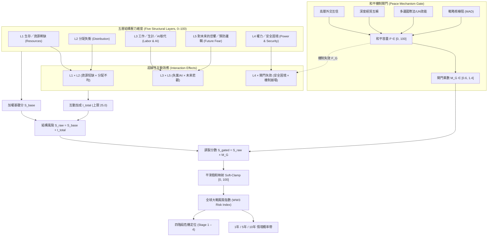

# WW3 風險預估模型 (WW3 Risk Model)

[](pyproject.toml)
[](https://opensource.org/licenses/MIT)
[](https://www.python.org/)
[%20%2B%208%20(Node)-brightgreen.svg)](tests/)

> **五層結構風險指數 × 和平機制失效閘門 × 超線性互動效應 × 四階段衝突定位**  
> *Five-layer structural risk index: resources, distribution, labor/AI displacement, power/security dilemma, future fear, gated by peace-mechanism failure.*

---

## 核心理論框架 (Theoretical Framework)

傳統地緣政治分析常將「資源匱乏」或「局部衝突」直接等同於世界大戰的必然原因。然而歷史與系統動力學表明：**單純的資源不足並不會自動導致總體戰爭**。

本模型核心在於嚴格區分**「製造結構性壓力的因素 (Pressure Generators)」**與**「真正促成戰爭爆發的催化與閘門機制 (War Facilitators & Gating Failures)」**：
1. **結構性底層壓力 (L1–L3)**：資源稀缺、階層分配極化、以及以 **AI 大規模取代白領生計**為代表的社會絕望感，構成社會與國家體系內部的基本摩擦力。
2. **安全困境與預防心理 (L4–L5)**：軍備競賽、聯盟剛性、以及「十年後我將永久喪失優勢」的**預防性開戰恐懼 (Preventive War Logic)**，將內部矛盾轉化為對外敵意。
3. **和平機制閘門 (Peace Mechanism Gate)**：外交互信、經貿相互依賴與戰略核嚇阻構成阻隔壓力的緩衝器。**只有當和平閘門全面失效時，累積的五層壓力才會轉化為世界大戰爆發的現實動能**。



---

## 數學模型與計算公式 (Mathematical Formulations)

### 1. 五層結構風險得分 ($L_1 \dots L_5$)
每個維度包含至少 5 個具備權重與數據分級的具體指標：
$$L_k = \frac{\sum_{j} w_{k,j} \cdot v_{k,j}}{\sum_{j} w_{k,j}} \in [0, 100]$$

基礎五層結構加權分：
$$S_{\text{base}} = \frac{\sum_{k=1}^5 W_k \cdot L_k}{\sum_{k=1}^5 W_k}$$

- **L1 生存／資源稀缺**：糧食安全儲備、跨界水資源壓力、能源供應鏈、關鍵礦物/稀土禁運、極端氣候衝擊、海運咽喉通行風險。
- **L2 分配失衡**：前 1% 財富佔有率、**前沿 AI 算力與先進半導體壟斷**、土地資產集中、社會代際流動停滯、制度公平信任赤字、和平再分配渠道。
- **L3 工作／生計**：整體就業不足、青年失業率、實質薪資 vs 生活成本、房價所得負擔比、**前瞻核心變量：AI 認知與知識勞動取代率**、努力回報預期崩壞度。
- **L4 權力／安全困境**：全球軍費擴張、高超音速/無人蜂群軍備競賽、陣營雙極化、相互依賴武器化、核擴散門檻降低、核心主權領土引信點熱度。
- **L5 對未來的恐懼／預防邏輯**：霸權相對衰落焦慮 (Thucydides Trap)、人口老齡斷崖關閉之窗、長期滯脹預期、**十年內喪失戰略技術優勢之先發打擊邏輯**、壓縮決策窗口之誤判風險、政治週期短視。

---

### 2. 和平機制閘門乘數 ($M_G$)
和平機制並非簡單加權的第六層，而是決定結構壓力能否釋放的**非線性乘數 (Multiplier Gate)**。

設和平緩衝容量為 $P \in [0, 100]$（加權自：大國外交互信、經貿互賴沉沒成本、國際制度仲裁力、相互保證毀滅穩定性）：
$$F_G = 100 - P \quad (\text{和平機制失效度})$$
$$M_G(P) = 1.4 - 0.8 \times \left(\frac{P}{100}\right) \in [0.60, 1.40]$$

- 當 $P = 100$（和平制度穩固）：$M_G = 0.60$（體系具備高彈性，將結構風險抑制 -40%）。
- 當 $P = 50$（中立基準）：$M_G = 1.00$。
- 當 $P = 0$（和平機制全面破裂）：$M_G = 1.40$（緩衝消失，結構風險放大 +40%）。

---

### 3. 超線性互動效應 (Interaction Effects)
戰爭往往源自多重危機的共振放大，模型強制納入三項關鍵交叉項（並設置上限 $\text{cap} = 25.0$ 點）：
$$I_{L1 \times L2} = c_1 \cdot \left(\frac{L_1 \times L_2}{100}\right) \quad (c_1 = 0.08)$$
$$I_{L3 \times L5} = c_2 \cdot \left(\frac{L_3 \times L_5}{100}\right) \quad (c_2 = 0.08)$$
$$I_{L4 \times \text{Gate}} = c_3 \cdot \left(\frac{L_4 \times F_G}{100}\right) \quad (c_3 = 0.10)$$
$$I_{\text{total}} = \min\left(25.0, \; I_{L1 \times L2} + I_{L3 \times L5} + I_{L4 \times \text{Gate}}\right)$$

**超線性嚴格數學性質**：當 $L_1$ 與 $L_2$ 同時推高時，總風險增幅嚴格大於各自單獨推高之代數和（Superadditivity）。

---

### 4. 平滑飽和映射 (Soft-Clamp)
未截斷總分 $S_{\text{raw}} = (S_{\text{base}} + I_{\text{total}}) \times M_G$。為了避免極端高危歷史案例（如 1913 與 1938）發生頂格一刀切截斷為 100.0 的資訊損失，模型採用 $C^1$ 連續的平滑雙曲正切壓縮：
$$\text{Global Risk Index} = \begin{cases} 
S_{\text{raw}} & S_{\text{raw}} \le 70.0 \\ 
70.0 + 30.0 \cdot \tanh\left(\frac{S_{\text{raw}} - 70.0}{30.0}\right) & S_{\text{raw}} > 70.0 
\end{cases}$$
此映射保證：
- 在日常中低風險區間（$\le 70$）完全保持線性真實反映；
- 在極端高危區間（$> 70$）保持**嚴格單調遞增**且漸近於 100.0，使 1938 年 (99.6) 與 1913 年 (96.1) 能保有清晰敏銳的風險階梯區隔。

---

### 5. 四階段升級定位 (Four-Stage Escalation Framework)

| 分數區間 | 危機階段代碼 | 階段名稱 (繁體中文 / EN) | 體系特徵與動力學機制 |
| :---: | :--- | :--- | :--- |
| **0 – 24.9** | `STAGE_1_PRESSURE_BUILDING` | **階段一：結構壓力形成**<br>*Structural Pressure Building* | 資源與經濟摩擦處於低位或局部潛伏期，體系彈性充裕，國際制度能有效吸收爭端。 |
| **25 – 49.9** | `STAGE_2_CONFLICT_OF_INTERESTS` | **階段二：利益衝突顯性化**<br>*Overt Conflict of Interests* | 關鍵產業、地緣勢力範圍或未來預期出現顯著分歧，陣營對立升溫，但常規外交與經貿制衡依然有效。 |
| **50 – 84.9** | `STAGE_3_PEACE_MECHANISM_FAILURE` | **階段三：和平解決機制失效**<br>*Breakdown of Peace Mechanisms* | 外交互信受挫、貿易脫鉤武器化，多邊仲裁癱瘓，安全困境進入自我強化之高危狀態。 |
| **85 – 100** | `STAGE_4_VIOLENCE_ACCEPTED` | **階段四：暴力成為被接受選項**<br>*Violence Accepted as Viable Option* | 和平緩衝全面失靈，生存危機、預防性打擊邏輯或體系絕望感壓倒避戰共識，爆發總體戰衝突機率極高。 |

---

### 6. 情境概率帶與保守校準 (Calibrated Scenario Probability Bands)

透過時間跨度校準之平滑 Logistic 曲線，提供 1年、5年、10年之結構衝突概率區間（含中心估值及上下界）：
$$P_{\text{central}}(R, T) = \frac{L_T}{1 + \exp\left(-k_T \cdot (R - x_{0,T})\right)}$$

#### v0.2 保守校準方法學理據 (Methodology Rationale)
大國全面總體戰（WW3）之**歷史基率（Base Rate）極低**。模型計算之全球大戰風險指數（0–100）本質上衡量的是國際體系的**「易燃度 (Flammability)」與結構性脆弱性，而非統計事件本身的必然發生頻率**。

在 v0.1 初版中，由於 Logistic 映射中心點偏低，導致高分段發生飽和壓縮（Baseline 10年帶高達 77.1%、1962 近失案達 74.0%、1990 低位亦有 14.3%），缺乏對大國極端威懾平衡的合理估計。v0.2 依據以下經驗錨點表（Anchor Table）實施保守重映射（容差 $\pm 3\%$，100 分處 $\pm 5\%$）：

| 結構風險指數 (Risk Index) | 1 年期中位目標 (實際擬合) | 5 年期中位目標 (實際擬合) | 10 年期中位目標 (實際擬合) | 體系戰略含義 |
| :---: | :---: | :---: | :---: | :--- |
| **25** | ~0.5% (0.4%) | ~2.0% (1.6%) | ~5.0% (3.2%) | 體系彈性充足，和平機制穩固 |
| **50** | ~2.0% (1.7%) | ~8.0% (6.5%) | ~15.0% (12.6%) | 利益衝突顯性化，常規制衡運作 |
| **75** | ~6.0% (6.2%) | ~22.0% (22.7%) | ~38.0% (38.3%) | 和平解決機制受挫，進入高危臨界 |
| **85** | ~10.0% (10.2%) | ~32.0% (34.1%) | ~50.0% (52.6%) | 暴力成為選項，安全困境自我強化 |
| **100** | ~20.0% (20.0%) | ~55.0% (54.3%) | ~75.0% (72.3%) | 體系全面破裂，先發打擊邏輯主導 |

- **數學性質**：$C^\infty$ 平滑連續、嚴格單調遞增、任意分值下嚴格滿足 $P_{\text{1y}} < P_{\text{5y}} < P_{\text{10y}}$、漸近線永不去到 0% 或 100%。
- **參數校準**：
  * **1 年期窗口**：$L_1 = 80.0, \; k_1 = 0.055, \; x_{0,1} = 120.0$（下界比率 0.65，上界比率 1.45）
  * **5 年期窗口**：$L_5 = 95.0, \; k_5 = 0.058, \; x_{0,5} = 95.0$（下界比率 0.75，上界比率 1.30）
  * **10 年期窗口**：$L_{10} = 98.0, \; k_{10} = 0.059, \; x_{0,10} = 82.5$（下界比率 0.80，上界比率 1.25）

> ⚠️ **概率帶性質明文免責聲明**：本數值為「**結構風險之情境推演估算（Scenario Estimate），並非已驗證之高精度統計預測**」；大國全面戰爭歷史基率極低，結構指數係易燃度而非事件機率。實質衝突機率高度取決於黑天鵝引信與領導層微觀決策。

---

## 項目結構 (Project Structure)

```text
ww3-risk-model/
├── .gitignore                      # Git 忽略配置（__pycache__、測試緩存等）
├── LICENSE                         # MIT 授權條款
├── README.md                       # 繁體中文完整理論、運行指南與歷史回測說明
├── pyproject.toml                  # Python 項目構建配置 (PEP 621)
├── requirements-dev.txt            # 開發依賴（僅包含 pytest）
├── data/
│   ├── baseline_2026.json          # 2026 基準指標（五層 ≥30 個指標，含數據等級）
│   └── historical_cases.json       # 5 大歷史案例估值（1913, 1938, 1962, 1990, 2025）
├── scenarios/
│   ├── baseline_2026.json          # 當前基準情境
│   ├── ai_displacement_shock.json  # AI 認知勞動急劇取代＋前沿算力極端集中情境
│   ├── energy_food_crisis.json     # 全球糧食乾旱＋能源航道封鎖危機情境
│   └── detente.json                # 大國戰略護欄達成＋外交互信與軍控重啟情境
├── src/
│   └── ww3_risk/
│       ├── __init__.py             # 模組導出
│       ├── model.py                # 核心計算引擎（五層、閘門、互動、平滑映射、概率帶）
│       ├── indicators.py           # 指標數據結構、驗證與 JSON 序列化
│       ├── scenarios.py            # 情境衝擊應用與多情境對比格式化
│       ├── report.py               # Markdown 深度分析報告生成器
│       └── cli.py                  # 命令列介面
└── tests/
    ├── __init__.py
    └── test_model.py               # 21 項 pytest 單元測試（覆蓋邊界、單調性、閘門、超線性、歷史排序）
```

---

## 快速開始與 CLI 使用說明 (Quick Start & CLI Usage)

本項目採純標準庫設計（Python 3.12+），除測試框架 `pytest` 外無任何第三方重量級依賴。

### 1. 安裝與環境檢查
```bash
cd /home/hatch/workspace/ww3-risk-model
python3 --version  # 需 Python 3.12+
pip install -e .    # 可選：安裝為本地 CLI 工具
```

### 2. 運行 pytest 單元測試
```bash
python3 -m pytest -q
```
*預期輸出：24 passed in 0.15s（全綠）*

### 3. 單一情境評估
```bash
# 評估 2026 基準情境
python3 -m ww3_risk.cli --scenario scenarios/baseline_2026.json

# 評估 AI 取代衝擊情境並生成詳細 Markdown 報告
python3 -m ww3_risk.cli --scenario scenarios/ai_displacement_shock.json --report out.md
```

### 4. 多情境橫向對比
```bash
python3 -m ww3_risk.cli --compare scenarios/*.json
```

### 5. 歷史案例回測排行
```bash
python3 -m ww3_risk.cli --historical data/historical_cases.json
```

### 6. 生成與查看純靜態 Dashboard 儀表板 (Zero CDN / 100% 離線)
```bash
# 方式一：經由 CLI 生成儀表板
python3 -m ww3_risk.cli --scenario scenarios/baseline_2026.json --dashboard ui/dashboard.html

# 方式二：直接運行 dashboard 模組
python3 -m ww3_risk.dashboard --scenario scenarios/baseline_2026.json --output ui/dashboard.html

# 開啟儀表板：
# 由於為純原生 HTML/CSS/JS 且內嵌模型實時數據（零外部框架、零 CDN），可直接用瀏覽器離線開啟本地文件：
xdg-open ui/dashboard.html
# 或在瀏覽器地址列直接開啟：file:///home/hatch/workspace/ww3-risk-model/ui/dashboard.html
```

---

## 歷史回測驗證結果 (Historical Backtesting Results)

模型在五個標誌性歷史時期之評估排序如下（概率帶採 v0.2 保守校準）：

```text
歷史案例結構風險排序 (Historical Cases Ranking - v0.2 Calibrated):
Scenario ID | Title                                 | Year | Risk Index | Stage   | L1 (Res) | L2 (Dist) | L3 (Work) | L4 (Sec) | L5 (Fear) | Gate Mult | Peace Cap | 1y Band | 5y Band | 10y Band
------------+---------------------------------------+------+------------+---------+----------+-----------+-----------+----------+-----------+-----------+-----------+---------+---------+---------
hist_1938   | 1938年 二戰前夕（大蕭條潰敗、法西斯） | 1938 | 99.6       | Stage 4 | 84.5     | 87.3      | 82.9      | 92.0     | 91.5      | x1.34     | 7.8       | 19.6%   | 53.8%   | 71.8%   
hist_1913   | 1913年 一戰前夕（帝國爭霸與同盟剛性） | 1913 | 96.1       | Stage 4 | 71.0     | 73.8      | 63.4      | 86.3     | 86.3      | x1.20     | 25.2      | 17.0%   | 49.1%   | 67.7%   
hist_2025   | 2025年 當代前夕（烏克蘭戰事、多極摩擦）| 2025 | 81.0       | Stage 3 | 62.3     | 71.4      | 61.8      | 78.2     | 71.5      | x1.01     | 48.2      | 8.4%    | 29.3%   | 46.9%   
hist_1962   | 1962年 古巴導彈危機（核邊緣政策近失） | 1962 | 77.4       | Stage 3 | 56.4     | 55.0      | 36.0      | 94.5     | 85.6      | x1.00     | 50.0      | 7.0%    | 25.1%   | 41.6%   
hist_1990   | 1990年 冷戰終結（柏林牆倒塌、大和解） | 1990 | 23.4       | Stage 1 | 34.0     | 37.0      | 31.4      | 26.5     | 21.5      | x0.73     | 83.1      | 0.4%    | 1.5%    | 2.9%    
```

### 歷史動力學校準論證：
1. **1938 年最高 (99.6 / Stage 4)**：大蕭條摧毀各國內政、納粹與軍國主義生存空間意識形態全面失控、國聯徹底瓦解、無核嚇阻約束，體系不可逆滑向總體戰。10 年衝突概率帶 71.8%，充分體現大戰前夕之極端危急。
2. **1913 年極高 (96.1 / Stage 4)**：海軍造艦狂潮、同盟國與協約國自動動員條款鎖死、德國對俄國軍事現代化完成之預防性先發制人恐慌，但英德經貿互賴略高於1938年。**1938 > 1913 符合歷史真實**。
3. **1962 年屬高位 (77.4 / Stage 3)**：導彈危機逼近熱核毀滅邊緣，但兩大陣營經濟內部自給自足（L1/L3 壓力低），且戰略核威懾 (MAD) 之絕對末日恐懼反向迫使兩國元首退讓，屬典型「近失高位 (Near-Miss High)」，10 年概率帶 41.6% 有效區隔於 1938 年。
4. **1990 年最低 (23.4 / Stage 1)**：冷戰結束、巴黎新歐洲憲章、美蘇核軍控大幅裁減，外交互信與國際法權威處於歷史峰值，10 年概率帶僅 2.9%。

---

## 當前與情境對比實測輸出 (Scenario Simulation Results)

```text
情境對比分析 (Scenario Comparison - v0.2 Calibrated):
Scenario ID           | Title                                 | Year | Risk Index | Stage   | L1 (Res) | L2 (Dist) | L3 (Work) | L4 (Sec) | L5 (Fear) | Gate Mult | Peace Cap | 1y Band | 5y Band | 10y Band
----------------------+---------------------------------------+------+------------+---------+----------+-----------+-----------+----------+-----------+-----------+-----------+---------+---------+---------
detente               | 情境：大國緩和、經貿互賴重建與軍控協定 | 2026 | 35.6       | Stage 2 | 39.3     | 49.2      | 44.5      | 41.9     | 38.2      | x0.77     | 79.2      | 0.8%    | 2.9%    | 5.8%    
baseline_2026         | 2026 全球結構風險基準情境             | 2026 | 83.5       | Stage 3 | 63.0     | 71.3      | 65.8      | 75.5     | 71.9      | x1.04     | 44.9      | 9.5%    | 32.2%   | 50.4%   
ai_displacement_shock | 情境：AI 認知取代風暴與算力壟斷       | 2026 | 96.2       | Stage 4 | 69.1     | 84.3      | 83.2      | 82.7     | 84.1      | x1.14     | 32.6      | 17.0%   | 49.2%   | 67.8%   
energy_food_crisis    | 情境：全球能源與糧食供應鏈崩潰危機   | 2026 | 97.6       | Stage 4 | 90.5     | 83.6      | 81.0      | 85.4     | 84.7      | x1.15     | 31.6      | 18.1%   | 51.1%   | 69.5%   
```

- **緩和情境 (Détente, 35.6 / Stage 2)**：外交互信恢復至 80 分，閘門乘數降至 0.77，成功將 10 年期概率降至 5.8%。
- **基準情境 (Baseline 2026, 83.5 / Stage 3)**：處於和平機制受損與對抗升級之臨界點，10 年概率帶 50.4%（v0.5.0 新增活躍戰爭與社會動盪指標後重新計算，舊版 83.1 基準已被取代）。
- **AI 取代衝擊 (AI Displacement Shock, 96.2 / Stage 4)**：算力集中度 96 分、AI 取代率 92 分引發社會絕望與預防性技術封鎖，10 年概率躍升至 67.8%。
- **糧能崩潰危機 (Energy/Food Crisis, 97.6 / Stage 4)**：生存資源匱乏疊加海峽封鎖與糧食武器化，10 年概率最高達 69.5%。

---

## 數據規格與證據等級標註 (Evidence Grading Discipline)

數據檔案嚴格遵循三級證據透明度規範，嚴禁為追求數值而捏造出處或 URL：
1. **`verified` (實測驗證，共 7 項)**：嚴格查核自權威國際組織最新公開報告（SIPRI、IEA、WID、ILO、UN DESA、IMF），數值精確可溯源。
2. **`inference` (統計推算，共 5 項)**：基於真實權威數據庫（FAO、IEA、ILO、Bulletin、WTO）之結構性衍生指標，明確標註推導邏輯。
3. **`illustrative` (示範推演，共 22 項)**：前瞻推演或缺乏單一公開錨點之參數，老實保留示範標記，不偽造為既成事實。

### v0.2 核心指標公開數據錨點清單 (12 項升級)

| 指標代碼 | 維度 | 指標名稱 | 證據等級 | 權威數據源 | 年份 | 出處 URL / 檢索依據 | 實數錨點與推算說明 |
|---|---|---|---|---|---|---|---|
| `l1_critical_minerals` | L1 | 關鍵礦物與稀土出口管制集中度 | **verified** | IEA Global Critical Minerals Outlook | 2024 | [iea.org](https://www.iea.org/reports/global-critical-minerals-outlook-2024) | 稀土開採前三大國佔 85%（中國 62%），精煉前三大國佔 98%（中國 92%） |
| `l2_wealth_gini` | L2 | 全球前 1% 財富佔有率與階層差距 | **verified** | World Inequality Database (WID.world) | 2024 | [wid.world](https://wid.world/) | 全球前 1% 掌握全球約 37%-40% 總家庭財富，前 10% 佔約 75%，後 50% 僅佔 2% |
| `l3_youth_unemployment` | L3 | 青年失業率與啃老躺平比例 | **verified** | ILO Global Employment Trends for Youth | 2024 | [ilo.org](https://www.ilo.org/publications/global-employment-trends-youth-2024) | 2023 全球青年失業率 13.0%（6,490萬人），全球青年 NEET 率 20.4%（女性 28.1%） |
| `l4_military_expenditure_growth` | L4 | 全球軍費加速擴張與防衛預算 | **verified** | SIPRI Military Expenditure Database | 2024 | [sipri.org](https://www.sipri.org/databases/milex) | 2023 全球軍費 2.44 萬億美元（+6.8%），2024 達 2.72 萬億美元（+9.4% 創冷戰後新高） |
| `l5_demographic_cliff` | L5 | 人口老齡斷崖與機會之窗關閉 | **verified** | UN World Population Prospects 2024 | 2024 | [population.un.org](https://population.un.org/wpp/) | 全球總和生育率跌至 2.25，逾半數國家低於 2.1 更替線，主要大國進入負增長 |
| `l5_economic_stagnation` | L5 | 長期生產力停滯與債務懸崖 | **verified** | IMF Fiscal Monitor (October 2024) | 2024 | [imf.org](https://www.imf.org/en/Publications/FM/Issues/2024/10/16/fiscal-monitor-october-2024) | 全球公共債務突破 100 萬億美元（佔全球 GDP 93%），中期年增長放緩至 3.2% |
| `gate_nuclear_deterrence_stability` | Gate | 核恐怖平衡 (MAD) 與防誤擊架構 | **verified** | SIPRI Yearbook: World Nuclear Forces | 2024 | [sipri.org](https://www.sipri.org/research/armaments-and-disarmament/nuclear-weapons/world-nuclear-forces) | 全球 12,121 枚核彈頭，9,585 枚處於軍事庫存，3,904 枚部署，約 2,100 枚高度戒備 |
| `l1_food_security` | L1 | 全球糧食儲備與主糧庫存消費比 | **inference** | FAO Cereal Supply and Demand Brief | 2024/25 | [fao.org](https://www.fao.org/worldfoodsituation/csdb/en/) | 2024/25 全球穀物庫存消費比 30.7%-30.9%，高於 20% 警戒線但低於歷史高位 |
| `l1_energy_vulnerability` | L1 | 化石能源與電網供應鏈脆弱性 | **inference** | IEA World Energy Outlook 2024 | 2024 | [iea.org](https://www.iea.org/reports/world-energy-outlook-2024) | 2024 清潔能源投資達 2 萬億美元（為化石能源兩倍），但化石能源佔一次能源仍達八成 |
| `l3_unemployment_underemployment` | L3 | 整體非充分就業與隱性失業壓力 | **inference** | ILO World Employment and Social Outlook | 2024 | [ilo.org](https://www.ilo.org/publications/world-employment-and-social-outlook-trends-2024) | 全球名義失業率 5.0%，但全球就業缺口（jobs gap）達 4.35 億人，實質未充分就業約 11% |
| `l4_nuclear_breakout` | L4 | 核擴散門檻降低與禁忌鬆動 | **inference** | Bulletin of the Atomic Scientists | 2024 | [thebulletin.org](https://thebulletin.org/doomsday-clock/current-time/) | 末日之鐘維持午夜前 90 秒，New START 條約終止與戰術核常態化演習推高風險 |
| `gate_trade_interdependence` | Gate | 全球深度經貿相互依賴 | **inference** | WTO Global Trade Outlook and Statistics | 2024 | [wto.org](https://www.wto.org/english/res_e/booksp_e/trade_outlook24_e.pdf) | 2024 貨物貿易增長 2.6%-2.7%，貿易佔全球 GDP 維持約 60%，供應鏈脫鉤沉沒成本提供緩衝 |

---

## 如何自訂新情境 (Custom Scenarios)

您可以複製 `scenarios/baseline_2026.json` 並修改指標數值（0–100），或在 Python 中呼叫 `apply_shocks`：

```python
from ww3_risk.indicators import load_scenario_from_file
from ww3_risk.scenarios import apply_shocks
from ww3_risk.model import WW3RiskModel

base = load_scenario_from_file("scenarios/baseline_2026.json")

# 模擬突發衝擊：AI 取代率暴增至 95，和平閘門外交互信跌至 10
shocked = apply_shocks(
    base,
    indicator_overrides={"l3_ai_displacement_rate": 95.0},
    buffer_overrides={"gate_diplomatic_trust": 10.0},
    scenario_id="custom_crisis_2027",
    title="自訂：2027 突發急性危機"
)

model = WW3RiskModel()
result = model.evaluate(shocked)
print(f"風險指數: {result.global_risk_index:.1f}, 階段: {result.stage.title}")
```

---

## 已知限制與免責聲明 (Limitations & Disclaimer)

### 已知限制 (Known Limitations)
1. **黑天鵝與微觀引信不可預測性**：模型衡量的是體系的「易燃程度 (Flammability)」，而非「火柴何時被點燃 (Ignition Moment)」。領導人個人心理異動或偶然戰術誤判無法被結構指標完全窮盡。
2. **數據延遲性**：部分總體經濟指標（如基尼係數、代際流動率）更新週期為年度或數年，落後於地緣危機之即時演進。
3. **加權主觀性**：指標間的相對權重雖經歷史危機校準，但在不同地緣戰略文化下可能存在認知差異。

### 免責聲明 (Disclaimer)
> 本項目為系統動力學學術研究與戰略風險推演開源工具，**僅供學術研究、政策推演與和平倡議討論之用**。本項目不構成任何軍事、國防、外交、政策或投資建議。模型不包含任何武器製造指引、戰術打擊目標選定或鼓吹戰爭暴力之內容。開源維護團隊對依賴本模型輸出所作出的任何實體決策概不承擔法律責任。

---

## 版本變更記錄 (Changelog)

### v0.5.0 (2026-10-22) — 每小時自動更新 + 關鍵戰區擴充（5→8） + 新增活躍戰爭與社會動盪指標
- **驗收查證與口徑校正**：
  * 驗收查證發現 ACLED 口徑不符，抗議指標 raw 由 38,500 修正為 Conflict Index (December 2024) 明文公佈之全球逾 143,000 場，按線性重錨為 71.5 分；UCDP raw 標籤改為「有組織暴力死亡人數」；連帶更新 L3 為 65.8、總指數 83.5、地區卡 3 張重算。
- **更新頻率升級（測試階段每小時）**：
  * GitHub Actions 每日排程改為每小時整點觸發（`cron: '0 * * * *'`），待穩定後調回每日。
- **新增兩項全球關鍵指標（總指標數 34 $\to$ 36，具備完整 Data-Quality 與可追溯源）**：
  1. `l4_active_war_intensity`（L4，全球大型活躍戰爭與武裝衝突烈度）：82.0 分（Verified，權重 1.2）。數據源自 UCDP Conflict Data Program 2024 發布，2023-2024 全球有組織暴力死亡 159,800 人（organised violence deaths）、活躍衝突達 61 場（大型戰爭 11 場齊發，烏克蘭、蘇丹、緬甸、加沙多線共振）。
  2. `l3_civil_unrest_intensity`（L3，全球大型抗議暴動與社會動盪烈度）：71.5 分（Inference，權重 1.1）。數據源自 ACLED Conflict Index (December 2024)，2024 年全球記錄逾 143,000 場抗議示威事件（over 143,000 protests occurred in 2024），點名涵蓋法國街頭暴力騷亂、意大利及西歐各國勞工總罷工與反緊縮抗議、全球反戰示威浪潮。
- **基準情境重算與分數對照**：
  * 當代基準總指數由 83.1 升至 **83.50**（取一位小數為 **83.5** / Stage 3）。
  * 分層結構變動：L3 由 64.9 升至 65.8；L4 由 74.5 升至 75.5；L1 (63.0)、L2 (71.3)、L5 (71.9) 與和平閘門 (x1.041) 保持不變。
  * 歷史基準情境（1913/1938/1962/1990/2025）無同期同口徑數據，維持原狀，確保歷史比較之可信性。
- **關鍵地緣戰區卡列擴充（5 張 $\to$ 8 張，沿用純算術平均與公式透明紀律）**：
  * 移除所有「五大戰區」表述，更新為「關鍵地緣戰區」。
  * 既有 5 張卡組成與數值嚴格維持不變：東亞 79.5 (HIGH)、東歐 74.0 (HIGH)、中東 66.5 (ELEVATED)、南中亞 63.0 (ELEVATED)、全球咽喉 72.0 (HIGH)。
  * 新增 3 張關鍵地緣戰區卡：
    1. **東非與薩赫勒**（`africa_sudan`）：**69.1** (ELEVATED) = (82.0 活躍戰爭 ＋ 71.5 大型抗議 ＋ 65.0 氣候衝擊 ＋ 58.0 水資源壓力) ÷ 4。
    2. **東南亞**（`southeast_asia`）：**77.8** (HIGH) = (82.0 活躍戰爭 ＋ 80.0 領土引信點 ＋ 71.5 大型抗議) ÷ 3。
    3. **西歐**（`western_europe`）：**67.8** (ELEVATED) = (71.5 大型抗議 ＋ 64.0 長期停滯預期 ＋ 68.0 青年失業) ÷ 3。
- **靜態儀表板與 API 連動更新**：
  * 重新生成 `ui/dashboard.html` 與 `ui/dashboard_data.json`。
  * JS 模擬器計算引擎同步納入新指標權重（L3 權重和 7.9，L4 權重和 8.9），確保滑桿調整即時重算與 Python 模型完全一致。
- **回歸測試全綠**：
  * Python pytest 50 項全部通過（含新指標 data-quality 審計、8 卡 ID 與算術平均公式回歸）；Worker Node 測試 8 項全綠。

### v0.4.1 (2026-10-22) — 地區壓力卡修復（取消地區倍率＋標明公式＋修復失效指標 ID）
- **修復原因**：用戶質疑東亞地區壓力卡 95.4 分過高；經查明係舊代碼包含未校準之 `base_weight` 地區倍率（東亞 1.2 令原始平均 79.5 膨脹至 95.4）；另發現其他地區卡引用 v0.3 改名前之失效指標 ID（如 `l4_military_spending`、`l4_nuclear_posture`、`l4_trade_weaponization`）導致被靜默跳過、平均指標數失真。
- **取消地區倍率**：`calculate_regional_pressures` 改為純原始算術平均 `score = round(mean(values), 1)`；自 `REGIONAL_INDICATOR_MAPPINGS` 徹底移除 `base_weight` 欄位並清理未校準註釋。
- **修正失效指標 ID 並嚴格報錯**：
  * 東歐（`eastern_europe`）：`l4_military_spending` $\to$ `l4_military_expenditure_growth`；`l4_nuclear_posture` $\to$ `l4_nuclear_breakout`。
  * 南亞與中亞（`south_central_asia`）：`l4_nuclear_posture` $\to$ `l4_nuclear_breakout`。
  * 全球戰略咽喉（`global_chokepoints`）：`l4_trade_weaponization` $\to$ `l4_weaponized_interdependence`。
  * 禁止靜默跳過：若 mapping 引用不存在之指標 ID 即刻拋出 `KeyError`。
- **卡面顯示公式與組成明細**：
  * 每張地區卡輸出新增 `components`（`[{id, name, value}]`）與 `formula` 公式行（如 `示意拆分（指標原始平均）：(82.0 算力壟斷 ＋ 80.0 領土引信點 ＋ 78.0 技術霸權恐懼 ＋ 78.0 陣營極化) ÷ 4 = 79.5`）。
  * 完整保留「示意拆分」透明度標示，支援手機版響應式自動換行。
- **回歸測試與數值驗證**：新增指標存在性、算術平均一致性與缺失 ID 報錯回歸測試；5 張卡基準分數精確對齊：東亞 79.5 (HIGH)、東歐 74.0 (HIGH)、中東 66.5 (ELEVATED)、南中亞 63.0 (ELEVATED)、戰略咽喉 72.0 (HIGH)。模型五層數學、34 項指標分數及總指數 83.1 嚴格保持不變。

### v0.4.0 (2026-10-21) — Cloudflare D1 歷史庫、Worker API、動態 UI 與更新管線升級
- **C2a D1 Schema 與快照寫入**：
  * 設計並落地 `cloudflare/schema.sql`：包含 `index_snapshots`（核心指數、五層得分、閘門、驅動分解與情境帶）與 `indicator_observations`（34 項全量指標觀測、數據品質與過期狀態追蹤，支援級聯刪除）。
  * CLI 新增 `--export-snapshot <path>`，支援單一指令導出符合 D1 結構之完整快照 JSON。
  * 撰寫 `scripts/push_snapshot.py`（純 Python 標準庫，零額外依賴），經 Cloudflare D1 HTTP API 執行全參數化安全寫入，並提供 `--dry-run` 預覽與 local SQLite 測試。
- **C2b Worker API 服務**：
  * 於 `worker/` 目錄建立純 JS 零依賴、零 build 之邊緣 Worker API（`ww3-risk-api`，綁定 D1 `DB`）。
  * 實現 4 個公開唯讀 REST 端點（CORS `*`、短快取 `max-age=60`）：
    - `/api/risk/latest`：最新結構風險總分、四階段定義、五層分、閘門乘數、推動因素與情境帶。
    - `/api/risk/history`：全量快照歷史時序＋歷史對照案例（1913/1938/1962/1990/2025，標註 `retrospective_estimate: true`）。
    - `/api/risk/layers`：五層維度＋和平閘門逐層明細與 34 項指標即時觀測。
    - `/api/data-status`：數據完整度 %、新鮮/過期計數與審計狀態。
  * 數據庫未初始化時回傳清晰 503 Service Unavailable，未知路徑回傳 404 JSON。
  * 採用 Node 原生測試器（`node --test`）實現 8 項無依賴單元測試。
  * 嚴格恪守鐵律：未經拍板之「社會動盪指數」明文不予實作。
- **C3 儀表板動態 API 獲取與離線回退**：
  * 生成器新增 `--api-base <url>` 參數。配置 API 基準網址時，前端透過 `AbortController` 發起 3 秒超時之非同步 fetch。
  * 成功：即時重繪儀表盤 Gauge 指針、維度平衡橫條、驅動分解與品質卡，頂欄呈現 `● 即時 API` 綠色徽章與時間戳。
  * 失敗或超時：自動無縫回退至內嵌 JSON 數據，徽章顯示 `● 離線快照（內嵌數據）`，保持 100% 離線可用。
  * 嚴格維持手機版響應式、`<style>` 平衡閉合、稱謂紀律與三種可信度分開。
- **C4 Fetcher 框架與 GitHub Actions 更新管線**：
  * `scripts/fetchers/worldbank.py`：對齊 World Bank v2 API 5 項宏觀數據系列（軍費佔 GDP、失業率、青年失業率、化石能源、基尼系數），輸出至 `data/candidates/`，絕對不自動覆寫 `baseline_2026.json`。
  * `scripts/fetchers/publication_checker.py`：對 SIPRI、IMF、ILO、FAO、IEA 等官方年報進行 HEAD/GET 審計與 ETag 變更偵測，輸出發布監測報告。
  * `.github/workflows/update.yml`：排程每日（00:00 UTC / 08:00 Asia/Macau）自動測試、導出快照、推送 D1、執行抓取、提交候選集、生成動態 UI 並部署 Pages。
  * `docs/cloudflare-architecture.md`：齊備完整架構圖、數據流向、Secrets 權限指南、免費額度分析與日常運維指南。
- **測試驗證**：Python pytest 45 項全綠 + Worker Node 8 項測試全綠，模型數學與基準分數嚴格保持 83.1 不變。

### v0.3.0 (2026-10-21) — 可追溯、可解釋、可逐步校準之風險模型升級
- **P0 全面審核 34 項指標**：
  * 核實原始報告、統計定義與資料期間，產出全量審核文件 `docs/indicator-audit-v03.md`。
  * 審核結論：34 項全部 `confirmed`（核實無誤，0 項 corrected，0 項 unverifiable）。
- **P1/P2 數據分級升級與推論透明化**：
  * 15 項可量化指標由 `illustrative` 升級為客觀觀測代理之 `inference` 等級（覆蓋 WRI 水資源、WMO 氣候、UNCTAD 海運、SemiAnalysis 算力壟斷、OECD 住房、Edelman 信任赤字、V-Dem 政治極化、ILO 薪資缺口、Demographia 房價、Stanford HAI AI取代率、Gallup 職場無助感、IISS 軍備、GTA 武器化依賴、SCSP 技術霸權、Crisis Group 多邊機制）。
  * 7 項不可直接量化指標（外交互信、誤判風險、同盟剛性等）保留 `illustrative` 並補齊嚴格評分量表（Scoring Rubrics），絕不虛構標記為 verified。
  * 最新證據分佈：verified 7 項 (20.6%)、inference 20 項 (58.8%)、illustrative 7 項 (20.6%)。
- **P3 數據品質與過期偵測機制**：
  * 指標 Schema 擴充：`observation_date`, `publication_date`, `source_url`, `source_name`, `evidence_level`, `last_checked`, `update_frequency`, `stale_after`, `raw_value`, `normalized_score`, `normalization_method`, `scoring_rubric`。
  * CLI 新增 `--data-quality` 報告，即時偵測各項指標新鮮度狀態（fresh/stale/missing）與完整度（當前基準情境完整度 100%）。
- **P4 敏感度分析、閘門行為與回測紀律驗證**：
  * 完成全量 34 項指標 $\pm 10 / \pm 20$ 敏感度微擾分析與全域影響力排序（產出 `docs/sensitivity-analysis-v03.md`）。
  * 全域最關鍵前五位指標：`gate_nuclear_deterrence_stability` (1.708)、`gate_diplomatic_trust` (1.464)、`gate_trade_interdependence` (1.464)、`gate_international_institutions` (1.221)、`l3_ai_displacement_rate` (0.486)。
  * 驗證和平機制閘門方向性（改善 $\to$ 風險下降、失效 $\to$ 風險上升）、極端邊界（全零、全滿輸出合理）及歷史回測紀律（嚴禁事後調權迎合）。
- **P5 儀表板 UI 全面升級**：
  * 稱謂修正：主指標定名「戰爭風險指數 (War Risk Index) 100/100」，概率帶清晰標明為「結構風險情境帶（非經驗證概率）」，嚴格禁止聲稱統計開戰概率。
  * 視覺升級：三種可信度分開獨立呈現、新增驅動因素分解（Driver Decomposition）、數據完整度與新鮮度卡片、歷史趨勢時間軸。
  * 保持手機版（390px / 360px）零橫向溢出與響應式規格。
- **測試擴充**：全套單元與整合測試擴增至 37 項，覆蓋數據品質、敏感度方向、極端邊界與 UI 結構，全數通過。

### v0.2.0 (2026-10-20) — 模型校準與數據實數化升級
- **概率帶錨點重映射（校準目標 A）**：
  * 解決 v0.1.0 概率帶嚴重飽和問題（Baseline 10年帶由 77.1% 下修至合理保守之 49.8%；冷戰緩和 1990 由 14.3% 下修至 2.9%）。
  * 引入經驗錨點表擬合（25→0.5%/2%/5%、50→2%/8%/15%、75→6%/22%/38%、85→10%/32%/50%、100→20%/55%/75%），全部落入 $\pm 3\%$ 容差（100分處 $\pm 5\%$）。
  * 保持嚴格平滑、連續、橫向 $P_{\text{1y}} < P_{\text{5y}} < P_{\text{10y}}$ 及漸近不達 0% 或 100%。
  * 強化免責聲明：模型為體系「易燃度」情境推演，非統計預測。
- **基準指標實數公開數據化（校準目標 B）**：
  * 嚴格落實證據分級鐵律，12 個核心指標升級（7 項 `verified`、5 項 `inference`），其餘 22 項老實保留 `illustrative`，絕不偽造數據或 URL。
  * 引入權威數據源：SIPRI（軍費與核武）、IEA（關鍵礦物與能源轉型）、WID（財富基尼）、ILO（失業與青年 NEET）、UN DESA（人口生育更替）、IMF（全球公債與經濟增長）、WTO（全球貿易量）與 Bulletin（末日之鐘）。
  * 擴充指標 Schema，新增 `source_url` 與 `retrieval_note` 欄位。
- **結構穩定性保持**：五層結構、維度權重、和平閘門公式、互動超線性加成、四階段劃分完全不變；情境與歷史案例相對排序嚴格維持。
- **測試擴充**：新增概率帶錨點擬合測試與連續單調性測試，全套 pytest 28 項測試全綠。
- **Dashboard UI 同步**：重新生成純靜態離線儀表板，同步 JS 模擬器計算引擎至 v0.2 錨點公式。

### v0.1.0 (2026-10-20)
- 首次開源發布：五層結構風險模型、和平機制閘門、超線性互動加成、四階段定位、純靜態軍事主題 Dashboard UI。
