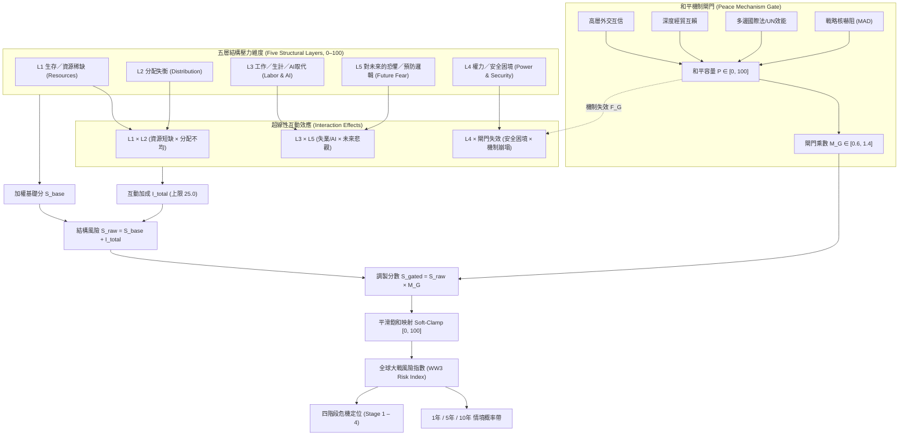

# WW3 風險預估模型 (WW3 Risk Model)

[](https://opensource.org/licenses/MIT)
[](https://www.python.org/)
[](tests/)

> **五層結構風險指數 × 和平機制失效閘門 × 超線性互動效應 × 四階段衝突定位**  
> *Five-layer structural risk index: resources, distribution, labor/AI displacement, power/security dilemma, future fear, gated by peace-mechanism failure.*

---

## 核心理論框架 (Theoretical Framework)

傳統地緣政治分析常將「資源匱乏」或「局部衝突」直接等同於世界大戰的必然原因。然而歷史與系統動力學表明：**單純的資源不足並不會自動導致總體戰爭**。

本模型核心在於嚴格區分**「製造結構性壓力的因素 (Pressure Generators)」**與**「真正促成戰爭爆發的催化與閘門機制 (War Facilitators & Gating Failures)」**：
1. **結構性底層壓力 (L1–L3)**：資源稀缺、階層分配極化、以及以 **AI 大規模取代白領生計**為代表的社會絕望感，構成社會與國家體系內部的基本摩擦力。
2. **安全困境與預防心理 (L4–L5)**：軍備競賽、聯盟剛性、以及「十年後我將永久喪失優勢」的**預防性開戰恐懼 (Preventive War Logic)**，將內部矛盾轉化為對外敵意。
3. **和平機制閘門 (Peace Mechanism Gate)**：外交互信、經貿相互依賴與戰略核嚇阻構成阻隔壓力的緩衝器。**只有當和平閘門全面失效時，累積的五層壓力才會轉化為世界大戰爆發的現實動能**。



---

## 數學模型與計算公式 (Mathematical Formulations)

### 1. 五層結構風險得分 ($L_1 \dots L_5$)
每個維度包含至少 5 個具備權重與數據分級的具體指標：
$$L_k = \frac{\sum_{j} w_{k,j} \cdot v_{k,j}}{\sum_{j} w_{k,j}} \in [0, 100]$$

基礎五層結構加權分：
$$S_{\text{base}} = \frac{\sum_{k=1}^5 W_k \cdot L_k}{\sum_{k=1}^5 W_k}$$

- **L1 生存／資源稀缺**：糧食安全儲備、跨界水資源壓力、能源供應鏈、關鍵礦物/稀土禁運、極端氣候衝擊、海運咽喉通行風險。
- **L2 分配失衡**：前 1% 財富佔有率、**前沿 AI 算力與先進半導體壟斷**、土地資產集中、社會代際流動停滯、制度公平信任赤字、和平再分配渠道。
- **L3 工作／生計**：整體就業不足、青年失業率、實質薪資 vs 生活成本、房價所得負擔比、**前瞻核心變量：AI 認知與知識勞動取代率**、努力回報預期崩壞度。
- **L4 權力／安全困境**：全球軍費擴張、高超音速/無人蜂群軍備競賽、陣營雙極化、相互依賴武器化、核擴散門檻降低、核心主權領土引信點熱度。
- **L5 對未來的恐懼／預防邏輯**：霸權相對衰落焦慮 (Thucydides Trap)、人口老齡斷崖關閉之窗、長期滯脹預期、**十年內喪失戰略技術優勢之先發打擊邏輯**、壓縮決策窗口之誤判風險、政治週期短視。

---

### 2. 和平機制閘門乘數 ($M_G$)
和平機制並非簡單加權的第六層，而是決定結構壓力能否釋放的**非線性乘數 (Multiplier Gate)**。

設和平緩衝容量為 $P \in [0, 100]$（加權自：大國外交互信、經貿互賴沉沒成本、國際制度仲裁力、相互保證毀滅穩定性）：
$$F_G = 100 - P \quad (\text{和平機制失效度})$$
$$M_G(P) = 1.4 - 0.8 \times \left(\frac{P}{100}\right) \in [0.60, 1.40]$$

- 當 $P = 100$（和平制度穩固）：$M_G = 0.60$（體系具備高彈性，將結構風險抑制 -40%）。
- 當 $P = 50$（中立基準）：$M_G = 1.00$。
- 當 $P = 0$（和平機制全面破裂）：$M_G = 1.40$（緩衝消失，結構風險放大 +40%）。

---

### 3. 超線性互動效應 (Interaction Effects)
戰爭往往源自多重危機的共振放大，模型強制納入三項關鍵交叉項（並設置上限 $\text{cap} = 25.0$ 點）：
$$I_{L1 \times L2} = c_1 \cdot \left(\frac{L_1 \times L_2}{100}\right) \quad (c_1 = 0.08)$$
$$I_{L3 \times L5} = c_2 \cdot \left(\frac{L_3 \times L_5}{100}\right) \quad (c_2 = 0.08)$$
$$I_{L4 \times \text{Gate}} = c_3 \cdot \left(\frac{L_4 \times F_G}{100}\right) \quad (c_3 = 0.10)$$
$$I_{\text{total}} = \min\left(25.0, \; I_{L1 \times L2} + I_{L3 \times L5} + I_{L4 \times \text{Gate}}\right)$$

**超線性嚴格數學性質**：當 $L_1$ 與 $L_2$ 同時推高時，總風險增幅嚴格大於各自單獨推高之代數和（Superadditivity）。

---

### 4. 平滑飽和映射 (Soft-Clamp)
未截斷總分 $S_{\text{raw}} = (S_{\text{base}} + I_{\text{total}}) \times M_G$。為了避免極端高危歷史案例（如 1913 與 1938）發生頂格一刀切截斷為 100.0 的資訊損失，模型採用 $C^1$ 連續的平滑雙曲正切壓縮：
$$\text{Global Risk Index} = \begin{cases} 
S_{\text{raw}} & S_{\text{raw}} \le 70.0 \\ 
70.0 + 30.0 \cdot \tanh\left(\frac{S_{\text{raw}} - 70.0}{30.0}\right) & S_{\text{raw}} > 70.0 
\end{cases}$$
此映射保證：
- 在日常中低風險區間（$\le 70$）完全保持線性真實反映；
- 在極端高危區間（$> 70$）保持**嚴格單調遞增**且漸近於 100.0，使 1938 年 (99.6) 與 1913 年 (96.1) 能保有清晰敏銳的風險階梯區隔。

---

### 5. 四階段升級定位 (Four-Stage Escalation Framework)

| 分數區間 | 危機階段代碼 | 階段名稱 (繁體中文 / EN) | 體系特徵與動力學機制 |
| :---: | :--- | :--- | :--- |
| **0 – 24.9** | `STAGE_1_PRESSURE_BUILDING` | **階段一：結構壓力形成**<br>*Structural Pressure Building* | 資源與經濟摩擦處於低位或局部潛伏期，體系彈性充裕，國際制度能有效吸收爭端。 |
| **25 – 49.9** | `STAGE_2_CONFLICT_OF_INTERESTS` | **階段二：利益衝突顯性化**<br>*Overt Conflict of Interests* | 關鍵產業、地緣勢力範圍或未來預期出現顯著分歧，陣營對立升溫，但常規外交與經貿制衡依然有效。 |
| **50 – 84.9** | `STAGE_3_PEACE_MECHANISM_FAILURE` | **階段三：和平解決機制失效**<br>*Breakdown of Peace Mechanisms* | 外交互信受挫、貿易脫鉤武器化，多邊仲裁癱瘓，安全困境進入自我強化之高危狀態。 |
| **85 – 100** | `STAGE_4_VIOLENCE_ACCEPTED` | **階段四：暴力成為被接受選項**<br>*Violence Accepted as Viable Option* | 和平緩衝全面失靈，生存危機、預防性打擊邏輯或體系絕望感壓倒避戰共識，爆發總體戰衝突機率極高。 |

---

### 6. 情境概率帶 (Scenario Probability Bands)
透過時間跨度校準之 Logistic 曲線，提供 1年、5年、10年之結構衝突概率區間（含中心估值及上下界）：
$$P_{\text{central}}(R, T) = \frac{C_T}{1 + \exp\left(-k_T \cdot (R - x_{0,T})\right)}$$

- **1 年期**：$C_1 = 30\%$, 聚焦急性引爆事件（Trigger Events），即使在高結構壓力下年化爆發率通常仍受軍工動員週期制約。
- **5 年期**：$C_5 = 65\%$, 結構性摩擦進入週期性共振與多次危機試探期。
- **10 年期**：$C_{10} = 85\%$, 大國權力轉移與技術洗牌窗口全面開啟之決定性決戰期。

> ⚠️ **概率帶性質明文標註**：本數值為「**結構風險之情境推演估算 (Scenario Estimate)，並非已驗證之高精度統計預測**」，實質衝突機率高度取決於黑天鵝引信與領導層微觀決策。

---

## 項目結構 (Project Structure)

```text
ww3-risk-model/
├── .gitignore                      # Git 忽略配置（__pycache__、測試緩存等）
├── LICENSE                         # MIT 授權條款
├── README.md                       # 繁體中文完整理論、運行指南與歷史回測說明
├── pyproject.toml                  # Python 項目構建配置 (PEP 621)
├── requirements-dev.txt            # 開發依賴（僅包含 pytest）
├── data/
│   ├── baseline_2026.json          # 2026 基準指標（五層 ≥30 個指標，含數據等級）
│   └── historical_cases.json       # 5 大歷史案例估值（1913, 1938, 1962, 1990, 2025）
├── scenarios/
│   ├── baseline_2026.json          # 當前基準情境
│   ├── ai_displacement_shock.json  # AI 認知勞動急劇取代＋前沿算力極端集中情境
│   ├── energy_food_crisis.json     # 全球糧食乾旱＋能源航道封鎖危機情境
│   └── detente.json                # 大國戰略護欄達成＋外交互信與軍控重啟情境
├── src/
│   └── ww3_risk/
│       ├── __init__.py             # 模組導出
│       ├── model.py                # 核心計算引擎（五層、閘門、互動、平滑映射、概率帶）
│       ├── indicators.py           # 指標數據結構、驗證與 JSON 序列化
│       ├── scenarios.py            # 情境衝擊應用與多情境對比格式化
│       ├── report.py               # Markdown 深度分析報告生成器
│       └── cli.py                  # 命令列介面
└── tests/
    ├── __init__.py
    └── test_model.py               # 21 項 pytest 單元測試（覆蓋邊界、單調性、閘門、超線性、歷史排序）
```

---

## 快速開始與 CLI 使用說明 (Quick Start & CLI Usage)

本項目採純標準庫設計（Python 3.12+），除測試框架 `pytest` 外無任何第三方重量級依賴。

### 1. 安裝與環境檢查
```bash
cd /home/hatch/workspace/ww3-risk-model
python3 --version  # 需 Python 3.12+
pip install -e .    # 可選：安裝為本地 CLI 工具
```

### 2. 運行 pytest 單元測試
```bash
python3 -m pytest -q
```
*預期輸出：21 passed in 0.08s（全綠）*

### 3. 單一情境評估
```bash
# 評估 2026 基準情境
python3 -m ww3_risk.cli --scenario scenarios/baseline_2026.json

# 評估 AI 取代衝擊情境並生成詳細 Markdown 報告
python3 -m ww3_risk.cli --scenario scenarios/ai_displacement_shock.json --report out.md
```

### 4. 多情境橫向對比
```bash
python3 -m ww3_risk.cli --compare scenarios/*.json
```

### 5. 歷史案例回測排行
```bash
python3 -m ww3_risk.cli --historical data/historical_cases.json
```

---

## 歷史回測驗證結果 (Historical Backtesting Results)

模型在五個標誌性歷史時期之評估排序如下：

```text
歷史案例結構風險排序 (Historical Cases Ranking):
Scenario ID | Title                                 | Year | Risk Index | Stage   | L1 (Res) | L2 (Dist) | L3 (Work) | L4 (Sec) | L5 (Fear) | Gate Mult | Peace Cap | 1y Band | 5y Band | 10y Band
------------+---------------------------------------+------+------------+---------+----------+-----------+-----------+----------+-----------+-----------+-----------+---------+---------+---------
hist_1938   | 1938年 二戰前夕（大蕭條潰敗、法西斯） | 1938 | 99.6       | Stage 4 | 84.5     | 87.3      | 82.9      | 92.0     | 91.5      | x1.34     | 7.8       | 28.2%   | 62.3%   | 82.1%   
hist_1913   | 1913年 一戰前夕（帝國爭霸與同盟剛性） | 1913 | 96.1       | Stage 4 | 71.0     | 73.8      | 63.4      | 86.3     | 86.3      | x1.20     | 25.2      | 27.7%   | 61.5%   | 81.4%   
hist_2025   | 2025年 當代前夕（烏克蘭戰事、多極摩擦）| 2025 | 81.0       | Stage 3 | 62.3     | 71.4      | 61.8      | 78.2     | 71.5      | x1.01     | 48.2      | 23.5%   | 56.0%   | 76.1%   
hist_1962   | 1962年 古巴導彈危機（核邊緣政策近失） | 1962 | 77.4       | Stage 3 | 56.4     | 55.0      | 36.0      | 94.5     | 85.6      | x1.00     | 50.0      | 21.9%   | 53.8%   | 74.0%   
hist_1990   | 1990年 冷戰終結（柏林牆倒塌、大和解） | 1990 | 23.4       | Stage 1 | 34.0     | 37.0      | 31.4      | 26.5     | 21.5      | x0.73     | 83.1      | 1.0%    | 6.4%    | 14.3%   
```

### 歷史動力學校準論證：
1. **1938 年最高 (99.6 / Stage 4)**：大蕭條摧毀各國內政、納粹與軍國主義生存空間意識形態全面失控、國聯徹底瓦解、無核嚇阻約束，體系不可逆滑向總體戰。
2. **1913 年極高 (96.1 / Stage 4)**：海軍造艦狂潮、同盟國與協約國自動動員條款鎖死、德國對俄國軍事現代化完成之預防性先發制人恐慌，但英德經貿互賴略高於1938年。**1938 > 1913 符合歷史真實**。
3. **1962 年屬高位 (77.4 / Stage 3)**：導彈危機逼近熱核毀滅邊緣，但兩大陣營經濟內部自給自足（L1/L3 壓力低），且戰略核威懾 (MAD) 之絕對末日恐懼反向迫使兩國元首退讓，屬典型「近失高位 (Near-Miss High)」。
4. **1990 年最低 (23.4 / Stage 1)**：冷戰結束、巴黎新歐洲憲章、美蘇核軍控大幅裁減，外交互信與國際法權威處於歷史峰值。

---

## 當前與情境對比實測輸出 (Scenario Simulation Results)

```text
情境對比分析 (Scenario Comparison):
Scenario ID           | Title                                 | Year | Risk Index | Stage   | L1 (Res) | L2 (Dist) | L3 (Work) | L4 (Sec) | L5 (Fear) | Gate Mult | Peace Cap | 1y Band | 5y Band | 10y Band
----------------------+---------------------------------------+------+------------+---------+----------+-----------+-----------+----------+-----------+-----------+-----------+---------+---------+---------
detente               | 情境：大國緩和、經貿互賴重建與軍控協定 | 2026 | 35.6       | Stage 2 | 39.3     | 49.2      | 44.5      | 41.9     | 38.2      | x0.77     | 79.2      | 2.6%    | 13.3%   | 26.2%   
baseline_2026         | 2026 全球結構風險基準情境             | 2026 | 83.1       | Stage 3 | 63.0     | 71.3      | 64.9      | 74.5     | 71.9      | x1.04     | 44.9      | 24.3%   | 57.0%   | 77.1%   
ai_displacement_shock | 情境：AI 認知取代風暴與算力壟斷       | 2026 | 96.2       | Stage 4 | 69.1     | 84.3      | 83.2      | 82.7     | 84.1      | x1.14     | 32.6      | 27.7%   | 61.6%   | 81.5%   
energy_food_crisis    | 情境：全球能源與糧食供應鏈崩潰危機   | 2026 | 97.6       | Stage 4 | 90.5     | 83.6      | 81.0      | 85.4     | 84.7      | x1.15     | 31.6      | 27.9%   | 61.9%   | 81.7%   
```

- **緩和情境 (Détente, 35.6 / Stage 2)**：外交互信恢復至 80 分，閘門乘數降至 0.77，成功將風險壓制於利益衝突階段。
- **基準情境 (Baseline 2026, 83.1 / Stage 3)**：處於和平機制受損與對抗升級之臨界點。
- **AI 取代衝擊 (AI Displacement Shock, 96.2 / Stage 4)**：算力集中度 96 分、AI 取代率 92 分引發社會絕望與預防性技術封鎖，風險躍升至階段四。
- **糧能崩潰危機 (Energy/Food Crisis, 97.6 / Stage 4)**：生存資源匱乏疊加海峽封鎖與糧食武器化，風險最高。

---

## 數據規格與證據等級標註 (Evidence Grading)

數據檔案嚴格遵循三級證據透明度規範，杜絕偽造真實數據：
1. **`verified` (核實數據)**：源自國際組織官方統計公報（如 SIPRI、IMF、WTO、World Bank 歷史序列數據）。
2. **`inference` (模型推論數據)**：基於學術文獻、智庫量化指數（如 V-Dem、Edelman、Allison 數據庫）之標準化推算。
3. **`illustrative` (示範情境數值)**：前瞻推演或 2026 模擬參數，代碼與數據檔顯式標明為模擬示範，不偽裝為既成事實。

---

## 如何自訂新情境 (Custom Scenarios)

您可以複製 `scenarios/baseline_2026.json` 並修改指標數值（0–100），或在 Python 中呼叫 `apply_shocks`：

```python
from ww3_risk.indicators import load_scenario_from_file
from ww3_risk.scenarios import apply_shocks
from ww3_risk.model import WW3RiskModel

base = load_scenario_from_file("scenarios/baseline_2026.json")

# 模擬突發衝擊：AI 取代率暴增至 95，和平閘門外交互信跌至 10
shocked = apply_shocks(
    base,
    indicator_overrides={"l3_ai_displacement_rate": 95.0},
    buffer_overrides={"gate_diplomatic_trust": 10.0},
    scenario_id="custom_crisis_2027",
    title="自訂：2027 突發急性危機"
)

model = WW3RiskModel()
result = model.evaluate(shocked)
print(f"風險指數: {result.global_risk_index:.1f}, 階段: {result.stage.title}")
```

---

## 已知限制與免責聲明 (Limitations & Disclaimer)

### 已知限制 (Known Limitations)
1. **黑天鵝與微觀引信不可預測性**：模型衡量的是體系的「易燃程度 (Flammability)」，而非「火柴何時被點燃 (Ignition Moment)」。領導人個人心理異動或偶然戰術誤判無法被結構指標完全窮盡。
2. **數據延遲性**：部分總體經濟指標（如基尼係數、代際流動率）更新週期為年度或數年，落後於地緣危機之即時演進。
3. **加權主觀性**：指標間的相對權重雖經歷史危機校準，但在不同地緣戰略文化下可能存在認知差異。

### 免責聲明 (Disclaimer)
> 本項目為系統動力學學術研究與戰略風險推演開源工具，**僅供學術研究、政策推演與和平倡議討論之用**。本項目不構成任何軍事、國防、外交、政策或投資建議。模型不包含任何武器製造指引、戰術打擊目標選定或鼓吹戰爭暴力之內容。開源維護團隊對依賴本模型輸出所作出的任何實體決策概不承擔法律責任。
